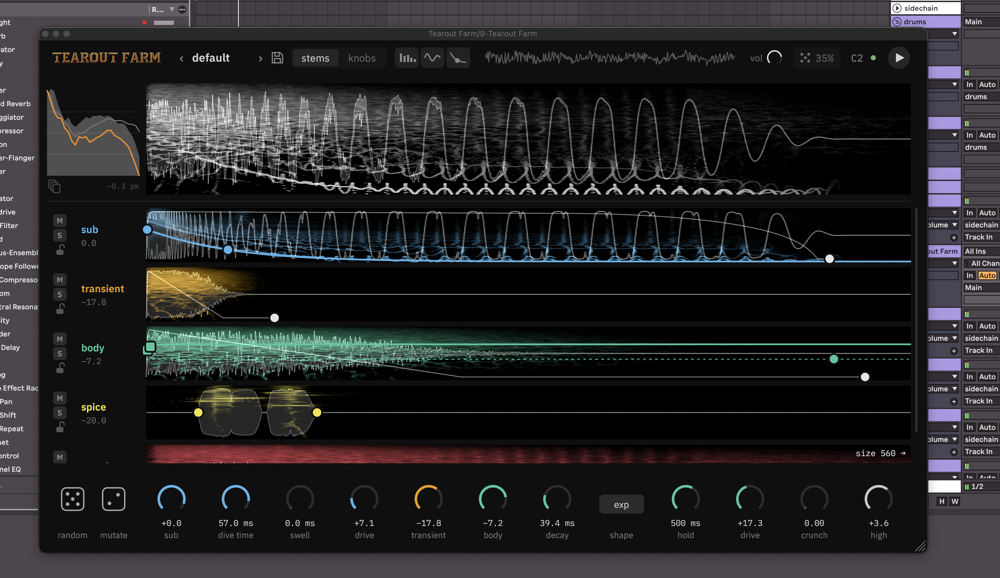

# Tearout Gun Synth

A browser synth for tearout guns, snares, chugs and pings. Everything renders offline in Web Workers, so randomize, mutate, stems and reference fitting all run on the page with no server.



**[Open it in web](https://lyramakesmusic.github.io/tearout-gun/)**

**[Download it as vst3](https://github.com/lyramakesmusic/tearout-gun/releases/tag/v0.1.0-beta)**

## Using it

- **family** picks what randomize makes: `fitted` and `gun` roll variations of guns fitted to real gun samples; `snare` rolls variations of ~3,750 snares fitted from a sample library; `chug` and `ping` have their own recipes; `808` and `whoosh` have their own engines (808: sub, FM, noise, post; whoosh: noise through moving filters for whooshes, swishes, crashes, wind, hype loops, impacts and foley).
- **randomize** rolls a new sound; **mutate** nudges the current one. Every group has its own **roll** and **lock**.
- Drop a file on **+ layer** to stack a sample; drop one on **reference** to A/B it, see its tonal balance against yours, and **fit** the current engine to it. For snares, fit plays a first guess within a fraction of a second, then refines it.
- Click a stem chip to solo it; drag it (or the main wav) into a DAW.
- **save** keeps patches in this browser.

## Engines

- **Gun** (`dsp/engine.js`): sub with pitch dive, noise transient, noisy/modal/FM body, synth layer, spice, samples → crunch chain (disperser, convolver, drive, OTT rack, freq shift) → mids chain with a clean sub path → reverb from synthesized IRs.
- **Snare** (`dsp/snare.js`, `dsp/snare_spec.js`): hit (a short burst on top of the bus clipper, for the front edge), click, tuned tone, noise with its own drive and crunchy noise types, metal, clap, room → width (symmetric, tail only) → bus with whip formant, OTT, snap and clip.
- **808** (`dsp/e808.js`): sine sub with a fast pitch dive and slow drift, FM with its own decay, noise click → saturation (tanh/hard/fold/tube) → tone → optional clean sub below a crossover → OTT, EQ, clip.
- **Whoosh** (`dsp/whoosh.js`): white/pink/brown/crackle/cymbal-metal source → curved amp envelope → filter sweeping start → peak → end with wobble → rhythmic chop → low body swell → symmetric width and pass-by → reverb, optional reverse → post.

## How the sounds are made

Presets and randomize anchors come from fitting the engines to real sounds: staged CMA-ES on a multi-resolution log-mel + long-term-spectrum + third-octave loss (`fit/`, `dsp/fitstages.js`). For snares the loss also matches the first 40 ms as a two-band envelope and the first 10 ms as a spectrum, so fits keep their attack. Randomize picks a fitted sound, jitters it (snares also swap whole layers between two fitted snares), and keeps the best of several candidates by a family reference.

The snare fit starts from an inverse model (`fit/train_inv2.py`, run in the browser as `web/inv2.onnx`): a CNN that reads a mel spectrogram and a fine pitch spectrum and predicts every knob. It is trained on renders around the fitted library, in a canonical pitch convention (the note is the tone's sounding pitch class), since note and the layer tunings otherwise trade off exactly. The fitter scores each CMA-ES generation in parallel across worker threads when the page is cross-origin isolated (`serve.js` sends the headers; on static hosts `web/coi-sw.js` adds them). Design notes from tutorial research are in `research/*/SYNTHESIS.md`; the experiment narrative is in `research_log.md`. `data/preset_map.json` maps preset names to the gun each was fitted to.

## Tearout Farm (plugin)

Tearout Farm is the gun engine as a VST3/CLAP instrument (and a standalone app), in Rust (`rust/`). Notes play the patch at their pitch; the editor shows each layer's stem as a spectrogram with its waveform, and any stem drags into the DAW as a WAV. It shares the web app's presets and its fitted randomize and mutate; saved presets and dragged-out stems live in the Tearout Farm folder (Application Support / %APPDATA% / ~/.local/share), which the preset menu shows and can change.

### Building

Install Rust with [rustup](https://rustup.rs), then from `rust/`:

```
cargo xtask bundle tearout-plug --release            # target/bundled/Tearout Farm.vst3 and .clap
cargo xtask bundle-universal tearout-plug --release  # macOS: one bundle for Apple silicon and Intel
cargo run --release --bin tearout-standalone         # the standalone app (computer keyboard: M toggles, A–; play)
```

On Linux, install the X11/GL development headers first (Debian/Ubuntu: `libx11-dev libx11-xcb-dev libxcb1-dev libxcursor-dev libgl-dev`, plus `libjack-jackd2-dev` for the standalone). For the plugin alone, add `--no-default-features` to the bundle command.

Copy the bundles into your plugin folders:

| | VST3 | CLAP |
|---|---|---|
| macOS | `~/Library/Audio/Plug-Ins/VST3/` | `~/Library/Audio/Plug-Ins/CLAP/` |
| Windows | `C:\Program Files\Common Files\VST3\` | `C:\Program Files\Common Files\CLAP\` |
| Linux | `~/.vst3/` | `~/.clap/` |

On macOS, a bundle copied from another machine needs its quarantine flag cleared: `xattr -dr com.apple.quarantine "Tearout Farm.vst3"`.

### Release bundle

`rust/scripts/dist.sh` builds one VST3 bundle holding macOS (universal), Windows x64 and Linux x64/arm64 binaries, plus a Nix package (`rust/scripts/linux/flake.nix`, `INSTALL.txt`). It builds macOS locally and the rest on a Linux build host with zig, cargo-zigbuild, cargo-xwin and Ubuntu focal sysroots (set `H=<host>`).

## Running the web app locally

```
node serve.js   # http://localhost:8642/web/
```

Any static server works; the page imports the engine from `../dsp/`.
